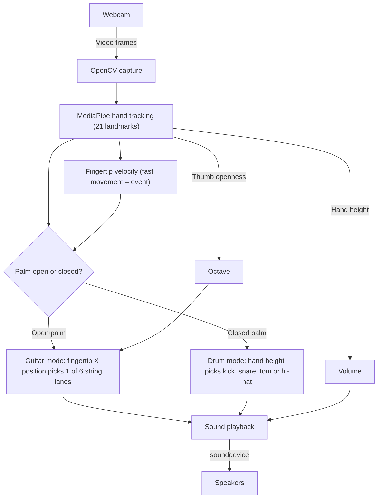

<div align="center">

# 🎸 Gruitre
### Play Guitar and Drums With Your Hand, Using Only a Webcam

[](https://www.python.org/)
[](https://opencv.org/)
[](https://developers.google.com/mediapipe)
[](https://numpy.org/)
[](https://python-sounddevice.readthedocs.io/)

*A webcam-controlled virtual instrument. MediaPipe tracks your hand, detects fast index-finger movements, and turns them into 6-string guitar tones or kick, snare, tom and hi-hat drum hits.*

[Features](#-features) • [Controls](#-controls) • [How It Works](#-how-it-works) • [Quick Start](#-quick-start) • [Troubleshooting](#-troubleshooting) • [Notes](#-notes)

</div>

---

## 🌍 Overview

You do not need a guitar or a drum kit to make some noise. **Gruitre** uses your camera to watch your hand and treats fast finger movement as the moment you "strike" an instrument.

The app combines four things:
1. **Webcam capture (OpenCV):** Streams live video frames into the app.
2. **Hand tracking (MediaPipe):** Finds 21 landmarks on your hand in every frame.
3. **Motion detection:** Measures fingertip velocity to decide when a pluck or a hit has happened.
4. **Gesture-driven sound:** An open palm plays guitar, a closed palm plays drums, and hand position controls volume and pitch.

---

## ✨ Features

- 📷 **Webcam capture:** Real-time video using OpenCV.
- ✋ **Hand landmark detection:** 21 landmarks per hand from MediaPipe.
- 🎸 **Guitar mode:** Maps your fingertip position to **6 string lanes**, and a fast index-finger movement plucks a note.
- 🥁 **Drum mode:** A fast movement with a closed palm plays a **kick, snare, tom or hi-hat**, chosen by hand height.
- 🔊 **Volume control:** Set by hand height.
- 🎚️ **Octave control:** Set by thumb openness.
- 🛠️ **Tunable:** Adjust the detection and sound parameters in `app.py`.

---

## 🎮 Controls

| Gesture | What it does |
| :--- | :--- |
| **Open palm** | **Guitar mode.** Move your index finger fast to **pluck** a 6-string note. The fingertip's X position picks the string lane. |
| **Closed palm** | **Drum mode.** Fast motion plays a **drum hit** (kick, snare, tom or hi-hat) based on your hand height. |
| **Hand height** | **Volume.** A lower wrist position gives a larger volume value, which means louder. |
| **Thumb openness** | **Octave (pitch).** |

---

## 🧱 How It Works



---

## 📂 Repository Structure

```text
guitar-and-Drum-using-OpenCV-/
├── app.py         # Camera capture, hand tracking, gesture logic and sound
└── README.md      # Project documentation
```

---

## 🚀 Quick Start

### Prerequisites
- **Python** `3`
- **Git**
- A working **webcam**
- Speakers or headphones

### 1. Clone the Repository
```bash
git clone https://github.com/KiranJITdesign/guitar-and-Drum-using-OpenCV-.git
cd guitar-and-Drum-using-OpenCV-
```

### 2. Create and Activate a Virtual Environment
```bash
python -m venv .venv

# Windows:
.venv\Scripts\activate
# macOS / Linux:
source .venv/bin/activate
```

### 3. Install Dependencies
```bash
pip install opencv-python mediapipe numpy sounddevice
```

> If `sounddevice` fails, install PortAudio support or try:
> `pip install sounddevice --user`

### 4. Run
```bash
python app.py
```

---

## 🧰 Troubleshooting

| Problem | Fix |
| :--- | :--- |
| `sounddevice` fails to install | Install PortAudio support, or try `pip install sounddevice --user`. |
| Plucks or hits are missed or triggered by accident | Use good lighting and keep the camera stable, then tune the parameters in `app.py`. |

---

## 📝 Notes

- Works best with good lighting and a stable camera.
- You can tune parameters in `app.py`.
- 
